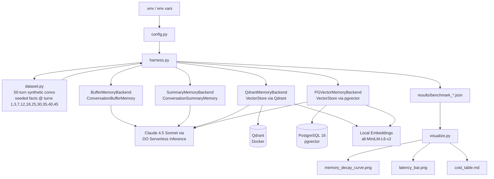

# Agent Memory Showdown

**Which memory backend keeps agents sharp at scale?**

A benchmark that stress-tests four LangChain memory backends across a 50-turn synthetic conversation and measures recall accuracy, retrieval latency, and token cost.

## Key Results

| Backend | Recall @ Turn 50 | Avg Latency/Turn | Cost / 1K Convos | Tokens/Run |
|---------|:-----------------:|:----------------:|:-----------------:|:----------:|
| **buffer** | 90% | 10.3s | $4,303 | 717K |
| **summary** | 42% | 36.0s | $2,256 | 376K |
| **qdrant** | 82% | 7.0s | $418 | 70K |
| **pgvector** | 82% | 7.0s | $416 | 69K |

**Winner:** Vector backends (qdrant/pgvector) — 82% recall at 1/10th the cost of buffer, with flat latency regardless of conversation length. Summary memory is the worst performer: slowest, lossy, and still expensive.

## Architecture



## Infrastructure

- **Compute:** Single DigitalOcean Droplet (8GB RAM / 4 vCPU, Ubuntu 24.04, BLR1)
- **LLM:** Claude 4.5 Sonnet via DigitalOcean Serverless Inference API (`anthropic-claude-4.5-sonnet`)
- **Embeddings:** Local sentence-transformers (`all-MiniLM-L6-v2`, 384-dim, CPU)
- **Vector DB:** Qdrant (Docker container) on the Droplet
- **Relational + Vector:** PostgreSQL 16 + pgvector extension on the Droplet

## Memory Backends

| Backend | Strategy | Strength | Weakness |
|---------|----------|----------|---------|
| `buffer` | Full conversation history | Perfect recall short-term | Context blows up, high cost |
| `summary` | LLM-compressed summary | Low token cost | Lossy — facts get summarized away |
| `qdrant` | Semantic vector search (Qdrant) | Fast, accurate retrieval, low cost | Requires Qdrant service |
| `pgvector` | Semantic vector search (PostgreSQL) | SQL-native, easy ops | Slightly slower than Qdrant at massive scale |

## Benchmark Design

- **50-turn synthetic conversation** — multi-topic (travel planning, tech preferences, personal details, work projects)
- **10 facts planted** at turns: 1, 3, 7, 12, 18, 25, 30, 35, 40, 45
- **Facts include:**
  - "My dog's name is Baxter"
  - "I'm allergic to shellfish"
  - "My flight to Tokyo is on March 15th"
  - "The project deadline is April 30th"
  - "My sister's wedding is in Lake Como, Italy"
  - "I'm reading 'Gödel, Escher, Bach'"
  - "My Wi-Fi password is 'sunkist-mango-42'"
  - "I take 10mg of melatonin before bed"
  - "My childhood best friend is Priya Sharma"
  - "My bank PIN is 7294"
- **Recall probed** at turns 15 and 50 (builds the memory decay curve); at each of these turns every fact planted earlier is asked about. Turns 25 and 35 appear in the default recall list but are also fact-seeding turns, and seeding wins, so they are never probed
- **Scoring:** exact match = correct / partial word match = partial / miss = failed
- **5 runs per backend** for statistical reliability

### Methodology notes and limitations

These are properties of the harness as written, not bugs, and they affect how the numbers should be read.

- **Probe reinforcement.** Recall probes are sent as ordinary chat turns (`src/harness.py`), so each probe and the model's answer are written into memory. The same probe text is asked again at later recall turns. For the vector backends, the turn-50 recall of a fact can therefore retrieve the turn-15 question and answer pair, not only the original statement. Buffer and summary also carry those earlier probes. The turn-50 scores measure recall of the fact plus any reinforcement from earlier probing, and the decay curve is flattered accordingly, especially for facts planted before turn 15. A clean measurement would probe each fact once, or probe against a memory snapshot that is not written back to.
- **Different prompts per backend family.** `buffer` and `summary` use LangChain's default `ConversationChain` prompt, while `qdrant` and `pgvector` use the custom `MEMORY_PROMPT` ("uses the relevant memory snippets below to answer accurately"). The wording differs, so part of any gap between the two families may come from prompt wording rather than the memory mechanism.
- **Probe turns are excluded from latency.** Recall turns record no `TurnMetrics`, so latency averages cover filler and seed turns only. Their tokens do count toward the totals.
- **Substring scoring.** `score_recall` checks that each word of the answer key appears anywhere in the reply, so a reply that merely mentions the words can score as correct.
- **Embeddings are local.** `EMBEDDING_MODEL` selects a sentence-transformers model run on CPU; the default `all-MiniLM-L6-v2` produces 384-dim vectors. `EMBEDDING_DIMENSION` (Qdrant collection size) must be changed together with it. The pgvector backend uses LangChain's `PGVector`, which creates its own tables, so the `memory_embeddings` table in `scripts/init_pgvector.sql` is not used.

## Metrics

| Metric | Description |
|--------|-------------|
| Recall Accuracy | Score at turns 15 and 50 (the decay curve) |
| Retrieval Latency | Time to fetch memory context per turn (ms) |
| Total Tokens Used | Input + output tokens across 50 turns |
| Cost per 1,000 Conversations | Extrapolated from token usage at Claude pricing |

## Results

Full results are in [`results/full_benchmark_results.md`](results/full_benchmark_results.md).

### Memory Decay Curve

All backends achieve 100% recall at turn 15. By turn 50:

| Backend | Turn 15 | Turn 50 | Drop |
|---------|:-------:|:-------:|:----:|
| buffer | 100% | 90% | -10% |
| summary | 100% | 42% | **-58%** |
| qdrant | 100% | 82% | -18% |
| pgvector | 100% | 82% | -18% |

Summary collapses after turn 12 — the summarizer aggressively compresses away specific details. Facts from turns 18–45 are essentially lost.

### Notable Finding

The Wi-Fi password (turn 30) and bank PIN (turn 45) were missed by **all** backends — including buffer, which had the data in the prompt. This is Claude's safety behavior refusing to repeat sensitive data, not a memory failure.

## Setup

### Prerequisites

- Docker and Docker Compose
- Python 3.11+
- DigitalOcean Serverless Inference API key

### Quick Start (Docker)

```bash
# 1. Copy and populate the env file
cp .env.example .env
# Edit .env: set DO_API_KEY

# 2. Run the full benchmark (starts Qdrant + Postgres automatically)
make run

# Results written to results/
# Charts written to results/charts/
```

### Local Run

```bash
# 1. Start backing services
make up

# 2. Install dependencies
pip install -r requirements.txt

# 3. Run
cp .env.example .env  # populate as above
python run_benchmark.py

# Quick smoke test (2 runs, 10 turns, buffer + summary only)
make run-quick
```

### Options

```
python run_benchmark.py --help

  --backends  buffer summary qdrant pgvector  (subset of backends)
  --runs      N    number of runs per backend (default: 5)
  --turns     N    conversation turns per run (default: 50)
  --results-dir    output directory           (default: results/)
  --no-viz         skip chart generation
```

## Remotion Video

An animated explainer video of the benchmark results is built with [Remotion](https://www.remotion.dev/) (React + TypeScript). 10 scenes, 1920x1080 @ 30fps, dark techy theme.

```bash
cd remotion
npm install
npx remotion studio      # preview in browser
npx remotion render src/index.ts AgentMemoryShowdown out/video.mp4  # render
```

## Project Structure

```
agent-memory-showdown/
├── run_benchmark.py          # entry point
├── Makefile                  # make run / make run-quick / make clean
├── docker-compose.yml        # Qdrant + PostgreSQL + benchmark app
├── Dockerfile
├── requirements.txt
├── .env.example
├── src/
│   ├── config.py             # env-driven config (DO API key, DB URIs)
│   ├── dataset.py            # synthetic conversation generator
│   ├── harness.py            # benchmark runner + aggregator
│   ├── llm_factory.py        # Claude + local embeddings
│   ├── visualize.py          # Plotly + Matplotlib charts
│   └── backends/
│       ├── base.py           # BaseMemoryBackend, scoring helpers
│       ├── buffer_memory.py  # ConversationBufferMemory
│       ├── summary_memory.py # ConversationSummaryMemory
│       ├── qdrant_memory.py  # VectorStoreRetrieverMemory via Qdrant
│       └── pgvector_memory.py# VectorStoreRetrieverMemory via pgvector
├── scripts/
│   ├── setup_droplet.sh      # Provision Qdrant + Postgres on DO Droplet
│   └── init_pgvector.sql     # DB schema for pgvector backend
├── remotion/                 # Animated explainer video (React + Remotion)
│   ├── src/
│   │   ├── Root.tsx          # Main composition (all 10 scenes)
│   │   ├── scenes/           # Scene1_Hook.tsx ... Scene10_Closing.tsx
│   │   ├── components/       # AnimatedLineChart, GlassCard, ChatBubble, etc.
│   │   ├── data/             # benchmarkData.ts (hardcoded results)
│   │   └── styles/           # theme.ts (colors, fonts)
│   └── package.json
└── results/
    ├── full_benchmark_results.md   # Detailed analysis
    ├── smoke_test_results.md       # Quick test results
    ├── video_script.md             # Video narration script
    ├── video_script_simple.md      # Simplified video script
    └── charts/
        └── cost_table.md
```

## Tech Stack

- Python 3.11+ / LangChain 0.2
- Claude 4.5 Sonnet (via DigitalOcean Serverless Inference)
- sentence-transformers (all-MiniLM-L6-v2, local embeddings)
- Qdrant client 1.11
- pgvector 0.3 + psycopg2
- Plotly 5 + Matplotlib 3.9
- Remotion 4.0 (React + TypeScript video)
- Docker Compose

## Status

**Complete** — Benchmark run finished April 17, 2026. Full results and animated video available.
