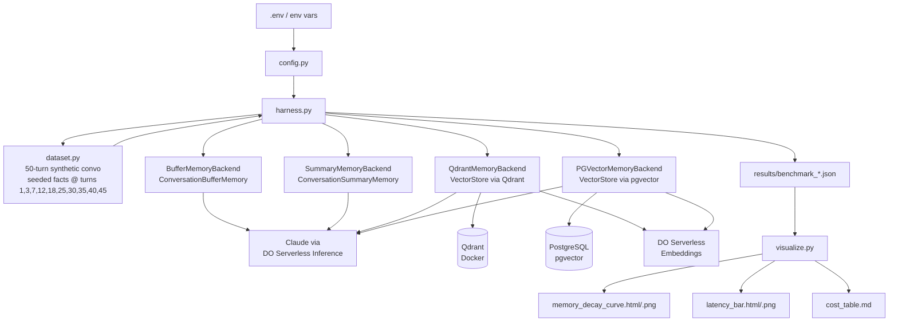

# Agent Memory Showdown

**Which memory backend keeps agents sharp at scale?**

A benchmark that stress-tests four LangChain memory backends across a 50-turn synthetic conversation and measures recall accuracy, retrieval latency, and token cost.

## Architecture



## Infrastructure

- **Compute:** Single DigitalOcean Droplet (8GB RAM / 4 vCPU, Ubuntu 24.04)
- **LLM:** Claude via DigitalOcean Serverless Inference API
- **Embeddings:** DigitalOcean Serverless Inference embedding models
- **Vector DB:** Qdrant (Docker) on the Droplet
- **Relational + Vector:** PostgreSQL 16 + pg_vector extension on the Droplet

## Memory Backends

| Backend | Strategy | Strength | Weakness |
|---------|----------|----------|---------|
| `buffer` | Full conversation history | Perfect recall short-term | Context blows up, high cost |
| `summary` | LLM-compressed summary | Low token cost | Lossy — facts may be summarized away |
| `qdrant` | Semantic vector search (Qdrant) | Fast, accurate retrieval, low cost | Requires Qdrant service |
| `pgvector` | Semantic vector search (PostgreSQL) | SQL-native, easy ops | Slightly slower than Qdrant at scale |

## Benchmark Design

- **50-turn synthetic conversation** — multi-topic (travel planning, tech preferences, personal details, work projects)
- **10 facts planted** at turns: 1, 3, 7, 12, 18, 25, 30, 35, 40, 45
- **Example facts:**
  - "My dog's name is Baxter"
  - "I'm allergic to shellfish"
  - "My flight to Tokyo is on March 15th"
  - "The project deadline is April 30th"
- **Recall quizzed** at turns 15, 25, 35, and 50 (builds the memory decay curve)
- **Scoring:** exact match (1.0) / partial match (0.5) / miss (0.0)
- **5 runs per backend** for statistical reliability

## Metrics

| Metric | Description |
|--------|-------------|
| Recall Accuracy | Score at turns 15, 25, 35, 50 (the decay curve) |
| Retrieval Latency | Time to fetch memory context per turn (ms) |
| Total Tokens Used | Input + output tokens across 50 turns |
| Cost per 1000 Conversations | Extrapolated from token usage at standard pricing |
| Memory Storage Size | Data volume per backend |

## Visualizations

### Memory Decay Curve
Line chart: recall accuracy (y-axis) vs. conversation turn (x-axis). One line per backend. Vector backends should hold a flat line; buffer drops sharply for early-seeded facts once the context window fills.

### Latency Bar Chart
Average retrieval latency per backend with error bars (std dev).

### Cost Table
Estimated USD cost per 1,000 conversations based on average token usage.

## Setup

### Prerequisites

- Docker and Docker Compose
- Python 3.11+
- DigitalOcean Serverless Inference API key

### Quick Start (Docker)

```bash
# 1. Copy and populate the env file
cp .env.example .env
# Edit .env: set DO_API_KEY

# 2. Run the full benchmark (starts Qdrant + Postgres automatically)
make run

# Results written to results/
# Charts written to results/charts/
```

### Local Run

```bash
# 1. Start backing services
make up

# 2. Install dependencies
pip install -r requirements.txt

# 3. Run
cp .env.example .env  # populate as above
python run_benchmark.py

# Quick smoke test (2 runs, 10 turns, buffer + summary only)
make run-quick
```

### Options

```
python run_benchmark.py --help

  --backends  buffer summary qdrant pgvector  (subset of backends)
  --runs      N    number of runs per backend (default: 5)
  --turns     N    conversation turns per run (default: 50)
  --results-dir    output directory           (default: results/)
  --no-viz         skip chart generation
```

## Project Structure

```
agent_memory_showdown/
├── run_benchmark.py          # entry point
├── Makefile                  # make run / make run-quick / make clean
├── docker-compose.yml        # Qdrant + PostgreSQL + benchmark app
├── Dockerfile
├── requirements.txt
├── .env.example
├── src/
│   ├── config.py             # env-driven config (DO API key, DB URIs)
│   ├── dataset.py            # synthetic conversation generator
│   ├── harness.py            # benchmark runner + aggregator
│   ├── llm_factory.py        # Claude + embeddings via DO inference
│   ├── visualize.py          # Plotly + Matplotlib charts
│   └── backends/
│       ├── base.py           # BaseMemoryBackend, scoring helpers
│       ├── buffer_memory.py  # ConversationBufferMemory
│       ├── summary_memory.py # ConversationSummaryMemory
│       ├── qdrant_memory.py  # VectorStoreRetrieverMemory via Qdrant
│       └── pgvector_memory.py# VectorStoreRetrieverMemory via pgvector
├── scripts/
│   ├── setup_droplet.sh      # Provision Qdrant + Postgres on DO Droplet
│   └── init_pgvector.sql     # DB schema for pgvector backend
└── results/
    ├── benchmark_example.json
    └── charts/
        ├── memory_decay_curve.html
        ├── memory_decay_curve.png
        ├── latency_bar.html
        ├── latency_bar.png
        └── cost_table.md
```

## Execution Plan

1. Provision DO Droplet + install Qdrant (Docker) and PostgreSQL + pg_vector
2. Set up repo + dependencies
3. Build the conversation generator + fact planting
4. Implement the 4 memory backends (Claude via DO inference)
5. Run benchmark (5 runs per backend)
6. Collect metrics + generate charts
7. Write up findings

## Tech Stack

- Python 3.11+
- LangChain 0.2
- Claude (via DigitalOcean Serverless Inference)
- DO Serverless Inference embedding models
- Qdrant client 1.11
- pgvector 0.3 + psycopg2
- Plotly 5 + Matplotlib 3.9
- Docker Compose

## Status

**Planning** — Infrastructure and code to be updated for DO + Claude.
