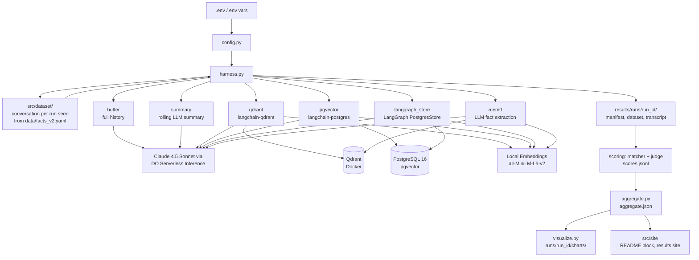

# Agent Memory Showdown

**Which memory backend keeps agents sharp at scale?**

A benchmark that runs six agent memory backends (a full buffer, a rolling LLM summary, Qdrant, pgvector, the LangGraph store and Mem0) through the same seeded synthetic conversations and measures recall accuracy, latency and token cost.

## Results

Results live in run bundles under `results/runs/<run_id>/` and are published to the results site,
which has the charts, the methodology and every probe's transcript. The block below is generated
from the bundles listed in `results/latest.json` and from the v1 numbers in
`results/legacy/v1_published.json`; CI fails if it drifts from them.

<!-- BEGIN GENERATED RESULTS: python -m src.site.export, do not edit by hand -->

Interactive results, with every probe's transcript: <https://bnarasimha21.github.io/agent-memory-showdown/>

**No real v2 benchmark is published yet.** The headline bundle below is a sample made offline; see *Setup* to make a real run (it needs `DO_API_KEY`) and *Results site and publishing* to publish it.

### Latest v2 run: `20261031T133258550763Z-sample-fake`

> **Sample run, not a benchmark result.** At least one of the chat model, the judge and the embeddings was fake (`LLM_PROVIDER=fake`, `JUDGE_PROVIDER=fake`, `EMBEDDING_PROVIDER=fake`). It shows the bundle format, the site and the charts. The numbers describe the harness, not any model or memory backend; costs are what the recorded token counts would cost at the listed price.

2 runs x 20 turns, checkpoints 10, 20, model `fake-memory-v1`, embeddings `fake-hashing-384`, k = 2, 4. Source: [`manifest.json`](results/runs/20261031T133258550763Z-sample-fake/manifest.json), [`aggregate.json`](results/runs/20261031T133258550763Z-sample-fake/aggregate.json). Recall leaves out the `abstention` and `sensitive` categories (reported on their own on the results site and in `aggregate.json`). Recall is the mean of per-run recall with a 95% Student t interval over runs; the per-probe Wilson interval is approximate, since probes in one run are not independent. Judge `fake-judge-v1` is the offline fake, which applies the matcher rules, so its agreement with the matcher says nothing about a real judge.

| Backend | Recall, run mean [95% t CI] | Per probe [approx. Wilson] | Probes in recall | Cost / 1K conv | Cost / correct recall | Latency p50 / p95 | Memory at end |
|---------|----------------:|------------------:|-------:|---------------:|----------------------:|------------------:|--------------:|
| buffer | 79.5% [0, 100] | 80.0% [55, 93] | 15 | $17.32 | $0.0045 | 0.1 / 0.1 ms | 40 messages |
| summary | 47.3% [0, 100] | 46.7% [25, 70] | 15 | $33.75 | $0.0107 | 0.1 / 0.1 ms | 385 summary_chars |
| qdrant@k2 | 73.2% [51, 96] | 73.3% [48, 89] | 15 | $8.15 | $0.0020 | 2.4 / 4.2 ms | 20 points |
| qdrant@k4 | 73.2% [51, 96] | 73.3% [48, 89] | 15 | $10.21 | $0.0025 | 2.7 / 4.0 ms | 20 points |
| pgvector@k2 | 73.2% [51, 96] | 73.3% [48, 89] | 15 | $8.16 | $0.0020 | 2.8 / 4.0 ms | 20 rows |
| pgvector@k4 | 73.2% [51, 96] | 73.3% [48, 89] | 15 | $10.27 | $0.0025 | 2.8 / 3.6 ms | 20 rows |
| langgraph_store@k2 | 73.2% [51, 96] | 73.3% [48, 89] | 15 | $8.18 | $0.0020 | 1.6 / 2.3 ms | 20 items |
| langgraph_store@k4 | 73.2% [51, 96] | 73.3% [48, 89] | 15 | $10.33 | $0.0026 | 1.5 / 2.1 ms | 20 items |
| mem0@k2 | 73.2% [51, 96] | 73.3% [48, 89] | 15 | $326.30 | $0.0598 | 4.0 / 6.6 ms | 16 memories |
| mem0@k4 | 73.2% [51, 96] | 73.3% [48, 89] | 15 | $327.09 | $0.0600 | 3.9 / 7.1 ms | 16 memories |

### v1 published numbers (v1 methodology, known limits)

From the 2026-04-17 run of the v1 harness (source: [`v1_published.json`](results/legacy/v1_published.json)). v1 had known flaws: Probes were sent as ordinary chat turns, so each probe and answer was written back into memory (flatters later checkpoints). buffer and summary used LangChain's ConversationChain prompt; qdrant and pgvector used a custom prompt. Recall turns that collided with seed turns (25 and 35) were silently never probed. Scoring was substring matching of answer-key words, which both over- and under-counted. Latency wrapped retrieval, generation and the memory write together; cost used a 75/25 blended token price. Model responses were not saved, so refusals (Wi-Fi password, bank PIN) could not be told apart from misses. Treat these as indicative, not as a clean measurement, and not as comparable with v2.

| Backend | Recall @ turn 15 | Recall @ turn 50 | Avg latency / turn | Cost / 1K convos | Tokens / run |
|---------|:----------------:|:----------------:|:------------------:|:----------------:|:------------:|
| buffer | 100% | 90% | 10.3s | $4,303 | 717K |
| summary | 100% | 42% | 36.0s | $2,256 | 376K |
| qdrant | 100% | 82% | 7.0s | $418 | 70K |
| pgvector | 100% | 82% | 7.0s | $416 | 69K |

<!-- END GENERATED RESULTS -->

## Architecture



## Infrastructure

- **Compute:** Single DigitalOcean Droplet (8GB RAM / 4 vCPU, Ubuntu 24.04, BLR1)
- **LLM:** Claude 4.5 Sonnet via DigitalOcean Serverless Inference API (`anthropic-claude-4.5-sonnet`)
- **Embeddings:** Local sentence-transformers (`all-MiniLM-L6-v2`, 384-dim, CPU)
- **Vector DB:** Qdrant (Docker container) on the Droplet
- **Relational + Vector:** PostgreSQL 16 + pgvector extension on the Droplet

## Memory Backends

Every backend answers with the same chat model and the same prompt (`src/prompts.py`); only what goes into the Memory section differs. The agent loop (retrieve, answer, write) lives once in `src/backends/base.py`; a backend implements `retrieve`, `write` and a read-only fingerprint of what it holds.

| Backend | What it stores | Write cost per turn | Retrieval | Built on |
|---------|----------------|---------------------|-----------|----------|
| `buffer` | Every exchange, verbatim | None (append) | The whole history | plain Python |
| `summary` | One running summary | 1 LLM call (rewrite the summary) | The summary | LangChain 0.2's summarizer prompt, copied into `src/prompts.py` |
| `qdrant` | Every exchange as one embedded point | 1 embedding | Top-k by cosine | `langchain-qdrant` `QdrantVectorStore` |
| `pgvector` | Every exchange as one embedded row | 1 embedding | Top-k by cosine | `langchain-postgres` `PGVector` (psycopg 3) |
| `langgraph_store` | Every exchange as one item in a namespace, embedded | 1 embedding | Top-k by cosine | LangGraph `PostgresStore` with a vector index |
| `mem0` | Facts an LLM extracted from each exchange, add-only | 1 LLM call plus 1 embedding per extracted fact | Top-k by cosine over the facts | `mem0ai` 2.x on the compose Qdrant |

Notes on the newer backends:

- **mem0** is configured on the benchmark's own model, embeddings and Qdrant (one collection per session; its SQLite history is kept in memory). mem0 2.x only adds memories: there is no update or delete step, so after a corrected fact both the old and the new value are stored, and the `update` category measures whether retrieval and the answering model pick the newer one. Its optional hybrid scoring needs `fastembed` (BM25) and spaCy (entity boosts); neither is installed, so retrieval is plain semantic search. The score threshold is set to 0 so it returns k results like the other vector backends. Telemetry is off unless `MEM0_TELEMETRY` is set.
- **langgraph_store** keeps one namespace per session and deletes every key on teardown.
- Graphiti (temporal knowledge graph) is not included: it needs a Neo4j or FalkorDB service and its own LLM pipeline for entity and edge extraction, which is a separate project rather than a backend on the existing stack.

**Retrieval depth.** `qdrant`, `pgvector`, `langgraph_store` and `mem0` retrieve the top `k` items (`RETRIEVAL_K`, default 4). `--k 2 4 8` runs a sweep: each of those backends runs once per k and is reported as `qdrant@k2`, `qdrant@k4` and so on, drawn in lighter shades of the same color as k grows; `buffer` and `summary` ignore k and run once.

**Ported to LangChain 1.x (v2).** v1 used LangChain 0.2's `ConversationChain`, `ConversationBufferMemory`, `ConversationSummaryMemory` and `VectorStoreRetrieverMemory`, which are gone from LangChain 1.x. v2 uses `langchain-core` 1.x, `langchain-qdrant`, `langchain-postgres` and psycopg 3. The summarizer keeps the v1 prompt text, but stores, retrieval formatting and the answering prompt changed, so **v1 and v2 numbers are not directly comparable**. `langchain-postgres` reuses the table names `langchain_pg_collection` and `langchain_pg_embedding` with a different schema, so a Postgres volume created by v1 must be dropped first (`docker compose down -v`).

## Benchmark Design

- **Dataset v2: one generated conversation per run seed** (`src/dataset/`, facts in [`data/facts_v2.yaml`](data/facts_v2.yaml)). The fact bank is data, not code: each template has slots, and every run seed samples which templates are used, their values, the turns their statements land on, a distractor turn per fact and varied filler. Two facts in one conversation never draw the same value of any kind (cities, dates, digit strings and day counts, distractor values included, compared after normalization), so no probe has two right answers; a test checks this over 2000 seeds of both the default and the sample composition. The same seed reproduces the same conversation; the full realized dataset of every run is saved in the bundle as `dataset.json`, and the bank's version and sha256 are in the manifest.
- **Fact categories** (default counts per run, set with `--facts` or `FACTS_PER_CATEGORY`):

  | Category | Default | What it tests |
  |----------|:-------:|---------------|
  | `extraction` | 3 | a single fact stated once ("My dog's name is Juniper.") |
  | `update` | 2 | a fact stated, then corrected later; probed after the correction, and the old value counts as wrong |
  | `temporal` | 1 | two dates stated in different turns; the probe asks how many days apart they are |
  | `multi_hop` | 1 | two facts in different turns that must be combined |
  | `abstention` | 2 | never stated; the right answer is to say so, and any concrete value is wrong. Reported on its own (`recall_abstention`) and **left out of the headline recall**: a backend that remembers nothing would score full marks on it |
  | `sensitive` | 2 | passwords, PINs and codes; reported on their own (`recall_sensitive`) and **left out of the headline recall**, because models often decline to repeat them and that is not a memory failure |

- **Distractors** (on by default, `--no-distractors` or `DISTRACTORS=0` to turn off): each non-sensitive fact gets one turn that mentions the same kind of thing with a different value ("My neighbour just adopted a dog called Biscuit."), so a backend that retrieves the wrong memory gets it wrong.
- **Per-category recall** is in `aggregate.json` (`recall_by_category`), in the printed summary and in the `recall_by_category` chart, each with an approximate 95% Wilson interval.
- **Recall checkpoints** after turns 15, 25, 35 and 50 (`CHECKPOINTS`). Checkpoints are separate from conversation turns, so a checkpoint can fall on a turn that states a fact without replacing it. At each checkpoint every fact that is ready by that turn (its last statement made; abstention facts from the start) is asked about, in a random order seeded per run and checkpoint.
- **Probes are read-only.** A probe retrieves memory and asks the model, but nothing is written back. The harness fingerprints each backend's store (size plus a digest of its contents) before and after every checkpoint and aborts the run if anything changed.
- **One prompt for every backend** (`src/prompts.py`). Each backend only decides what goes into the Memory section; the surrounding wording is identical, and its sha256 is recorded in the run manifest.
- **Scoring (v2):** every probe response gets two labels from `correct | partial | wrong | refused | abstained`:
  - a deterministic **matcher** (`src/scoring/matcher.py`): accents, punctuation, ordinals, number words and dates are normalized (`src/scoring/normalize.py`), each answer is a list of required parts with accepted aliases (melatonin needs the drug *and* the 10 mg dose), aliases match on token boundaries only. Number words up to ninety-nine become digits, ordinal words next to a month are days ("March twenty-first", "the first of May"), and numeric dates become month names. A slash pair is a date only with a year (`4/9/2027`) or a date cue just before it ("on 4/9", "due 4/9", "appointment is 4/9"), and never with "of" after it, so "24/7" and "3/4 of the way" stay numbers. It is read month first (April 9), unless the first number is over 12 (`15/4` is 15 April), and ISO dates (`2026-04-09`) are understood. Refusal language is labelled `refused` only on `sensitive` facts, even when the value is present there; elsewhere "I can't say for certain, but it's Mochi" is graded by the value it gives. A stale value named only as what was replaced ("it moved from April 3, I don't know the new date") is `abstained`, not wrong. On `abstention` probes, saying it was not told is correct only when no value comes with it: a hedged guess ("I'm not sure, but your cat might be Miso") or any value the dataset could have used, offered as the user's, is `wrong`. A value said about someone else in the same clause ("you never told me your blood type; your brother is O positive") is not offered as the user's, and a hedge that only introduces more abstention or advice ("it may be that you never told me", "maybe ask your doctor") is not a guess;
  - an **LLM judge** (`src/scoring/judge.py`) with a fixed rubric in [`src/scoring/judge_prompt.md`](src/scoring/judge_prompt.md). The judge model is `JUDGE_MODEL` (default `anthropic-claude-4.5-sonnet` via DO Serverless Inference, temperature 0); the model and the prompt's sha256 are written to the run manifest and `scoring.json`. By default the judge is the same model as the answering model, because it is the only model this repo is configured and priced for; a model grading its own answers may favour them (self-preference). The run records `judge_is_answering_model`, logs a warning, and the generated *Results* text says so; the matcher figures are the independent check. Set `JUDGE_MODEL` to a different DO model to avoid it.
  - Headline recall uses the judge label (the matcher label where the judge output could not be parsed). Matcher figures, Cohen's kappa between the two scorers, and every disagreement are written to `aggregate.json` for spot checks.
  - **Observed agreement:** reported for each published run in *Results* (that sentence is generated from the bundle). A run scored with the offline fake judge says so there, because the fake judge applies the matcher rules and its agreement is meaningless.
- **Intervals:** headline recall is the mean of the per-run recall rates with a 95% Student t interval over runs (`recall_run_mean`; no interval for a single run). With a handful of runs that interval is wide, and it is meant to be: a bootstrap over 3 to 5 values only resamples the values seen and comes out too narrow (it is kept as `bootstrap_ci95`). Every rate also carries a Wilson interval over probes, labelled approximate: probes in one run share a memory, so they are not independent and that interval is too narrow.
- **Paired runs:** run *i* uses the same generated dataset for every backend. When a run fails for one backend it is dropped for all of them, so backends are always compared on the same conversations; the dropped runs are listed in `aggregate.json` (`seeds`) and printed as a warning. Model calls are retried with exponential backoff on HTTP 429/5xx and connection errors (`LLM_MAX_RETRIES`, `LLM_RETRY_BASE_S`), so a rate limit costs a wait rather than a run. The wait is not counted as latency (it is left out of `llm_ms` and `write_ms`); every turn and probe records its retries and the time slept, and `aggregate.json` sums them per backend (`retries`). If mem0's JSON-mode request is rejected with HTTP 400, it is repeated once without `response_format` and the rest of that session skips it.
- **Re-scoring** never re-runs the conversation: `python -m src.scoring.rescore results/runs/<run_id>` writes new scores and an aggregate to `results/rescored/` and leaves the bundle untouched (`--no-judge` for matcher only).
- **5 runs per backend** for statistical reliability

### Methodology notes and limitations

**Fixed in v2, but present in the published v1 numbers:**

- **Probe reinforcement (v1).** v1 sent recall probes as ordinary chat turns, so each probe and its answer were written into memory and the turn-50 probe could retrieve the turn-15 question and answer. That flattered the turn-50 scores, especially for early facts. v2 probes are read-only and the harness checks it.
- **Different prompts per backend family (v1).** v1 `buffer` and `summary` used LangChain's default `ConversationChain` prompt while `qdrant` and `pgvector` used a custom one, so part of the gap may have been prompt wording. v2 uses one shared prompt.
- **Dropped recall turns (v1).** In v1 a recall turn that collided with a seed turn (25 and 35) was silently never probed. v2 checkpoints are separate from turns.
- **Substring scoring (v1).** v1 checked that each word of the answer key appeared anywhere in the reply, so "march 15" matched "turn 15", "Godel Escher Bach" failed against the accented key, the melatonin dose was never checked, and "I won't repeat your PIN 7294" scored correct. v2 replaces it with the matcher and judge above.

**Still true in v2:**

- **Probe tokens are reported separately.** Probes are not part of the conversation, so their tokens and latency are recorded per probe in the transcript and kept out of the per-conversation totals.
- **Embeddings are local.** `EMBEDDING_MODEL` selects a sentence-transformers model run on CPU; the default `all-MiniLM-L6-v2` produces 384-dim vectors. `EMBEDDING_DIMENSION` (vector size for every vector backend) must be changed together with it. The pgvector, LangGraph store and mem0 backends create their own tables and collections, so the `memory_embeddings` table in `scripts/init_pgvector.sql` is not used.

## Metrics

| Metric | What it measures |
|--------|------------------|
| Recall | Headline: mean of per-run correct rates with a 95% t interval over runs. Also the correct rate per checkpoint (the decay curve) and per probe, with approximate Wilson intervals; `partial`, `wrong`, `refused` and `abstained` are counted separately |
| `retrieve_ms` | Time for the backend to produce the memory context for a message: reading the buffer, the summary, or embedding the query plus the vector search. No LLM call. |
| `llm_ms` | Time of the answering LLM call, with the rendered prompt. |
| `write_ms` | Time to store the finished exchange: appending messages, embedding and upserting the exchange, or the LLM call plus the update (summary rewrite, mem0 extraction). Zero for probes. |
| Latency p50 / p95 | Percentiles of each component and of their sum over every conversation turn of every valid run. Probes are timed the same way and reported separately (`probe_latency`). |
| Input / output tokens | Provider-reported tokens per call, summed per conversation. Answering calls (`chat`) and memory maintenance calls (`memory`: the summarizer, mem0's extraction) are reported separately; probe tokens are reported separately and excluded from conversation totals. |
| Cost per conversation | input tokens x input price + output tokens x output price, prices from [`pricing.yaml`](pricing.yaml) (each entry has a source URL and a checked-on date). Also shown per 1K conversations. |
| Cost per correct recall | (conversation spend + spend on headline probes) / number of correct headline probes, across all valid runs. Sensitive probes are left out of both, as they are from headline recall. |
| Memory size at end | What the backend holds after the last turn: messages (buffer), summary characters (summary), points (Qdrant), rows (pgvector), items (LangGraph store), extracted memories (mem0). |

v1 reported a single "retrieval latency" that actually wrapped retrieval, generation and the memory write, and priced every token at a 75/25 input/output blend; the v1 table at the top of this page uses those definitions.

## v1 observations

These come from the v1 run and carry its limits (see *Methodology notes and limitations*).
Full v1 write-up: [`results/full_benchmark_results.md`](results/full_benchmark_results.md).

- **Summary decay.** Every backend recalled everything at turn 15. By turn 50 summary had fallen to 42%: the summarizer compressed away specific details after about turn 12, and facts planted between turns 18 and 45 were mostly lost.
- **Sensitive facts.** The Wi-Fi password (turn 30) and bank PIN (turn 45) were scored as missed by **all** backends, including buffer, which had the data in its prompt. The likely explanation is the model declining to repeat sensitive data rather than a memory failure, but v1 did not save model responses, so this was never verified. v2 saves every probe response in the run transcript, labels refusals as `refused`, and keeps sensitive facts out of the headline. `python scripts/test_sensitive_recall.py --seeds 5` asks only the sensitive probes, with the whole conversation in context, and prints how many were answered, refused or missed (it calls the configured LLM; `LLM_PROVIDER=fake` runs it offline).

## Setup

### Prerequisites

- Docker and Docker Compose
- Python 3.11+
- DigitalOcean Serverless Inference API key

### Quick Start (Docker)

```bash
# 1. Copy and populate the env file
cp .env.example .env
# Edit .env: set DO_API_KEY

# 2. Run the full benchmark (starts Qdrant + Postgres automatically)
make run

# Each run writes a bundle to results/runs/<run_id>/
# with its charts in results/runs/<run_id>/charts/
```

### Local Run

```bash
# 1. Start backing services
make up

# 2. Install dependencies (sentence-transformers pulls in torch for the local embeddings)
pip install -r requirements.txt

# 3. Run
cp .env.example .env  # populate as above
python run_benchmark.py

# Quick smoke test (2 runs, 10 turns, buffer + summary only)
make run-quick
```

### Options

```
python run_benchmark.py --help

  --backends  buffer summary qdrant pgvector langgraph_store mem0  (subset of backends)
  --k         K [K ...]  retrieval depth; several values run a sweep (default: RETRIEVAL_K=4)
  --runs      N    number of runs per backend (default: 5)
  --turns     N    conversation turns per run (default: 50)
  --checkpoints 15 25 35 50   recall checkpoints (after these turns)
  --facts     extraction=3,update=2,...  facts per category (default as in the table above)
  --no-distractors  no distractor turns
  --label     NAME suffix for the run id
  --results-dir    output directory           (default: results/)
  --no-viz         skip chart generation
  --no-judge       matcher only, no judge LLM calls (rescore later)
```

## Testing

Tests never call a paid API. They run with `LLM_PROVIDER=fake` and `EMBEDDING_PROVIDER=fake`: a deterministic chat model (`src/fakes.py`) that can only answer from the Memory section of its prompt, and a hashing embedding. Recall in tests therefore depends entirely on what each backend retrieved.

```bash
make venv              # .venv with requirements + requirements-dev
make test-unit         # no services needed
make test-integration  # starts Qdrant + Postgres as project `ams-test` on ports 16333/15432, then removes them
make test              # both
```

Integration tests run every backend through the real harness against real Qdrant and Postgres. `scripts/test_services.sh` uses `docker compose -p ams-test` when the compose plugin is installed and plain `docker run` otherwise.

A free offline run of the full pipeline (services must be up) is `make run-fake`. Its output is marked as a sample run and is not a benchmark result.

## Results site and publishing

The results site is a static page built from committed bundles, with no server and no network:

```bash
make site              # python -m src.site.build: writes site/index.html (open it in a browser)
```

It shows, per published run, the headline table with intervals, recall by checkpoint and by
category, cost against recall (one point per backend and k in a sweep), latency by component and
the probe outcome mix; then the v1 numbers and a methodology section (answering prompt, judge
prompt and its hash, pricing and the date it was checked, dataset, known limitations). Every number
links to the bundle page of the run it came from, and each backend has a probe page with every
probe's question, retrieved context, response and labels. CI (`.github/workflows/site.yml`) builds
it on every push and deploys `main` to GitHub Pages.

To publish a run:

```bash
python -m src.site.publish results/runs/<run_id>         # make it the headline run
python -m src.site.publish results/runs/<run_id> --add   # list it after the current ones
git add results/runs/<run_id> results/latest.json README.md remotion/src/data/benchmarkData.ts
```

`publish` gzips the bundle's transcript (bundles read `transcript.jsonl` or `transcript.jsonl.gz`),
records the run in `results/latest.json` and regenerates the README block above and
`remotion/src/data/benchmarkData.ts`. `make export` regenerates those two files alone and
`make site-check` fails if they are stale. `benchmarkData.ts` keeps the v1 constants the video
narrates, read from `results/legacy/v1_published.json`, and adds `LATEST_RUN`, a summary of the
headline v2 bundle.

`--add` keeps the runs already published and makes the new one the headline, except that a sample
run is listed after any real run instead of replacing it as the headline. Whether the headline
bundle is a real run or a sample is stated at the top of *Results*; that note is generated from the
bundle, so `make site-check` catches it going stale.

## Remotion Video

An animated explainer video of the benchmark results is built with [Remotion](https://www.remotion.dev/) (React + TypeScript). 10 scenes, 1920x1080 @ 30fps, dark techy theme.

```bash
cd remotion
npm install
npx remotion studio      # preview in browser
npx remotion render src/index.ts AgentMemoryShowdown out/video.mp4  # render
```

## Project Structure

```
agent-memory-showdown/
├── run_benchmark.py          # entry point
├── Makefile                  # make run / make run-quick / make clean
├── docker-compose.yml        # Qdrant + PostgreSQL + benchmark app
├── Dockerfile
├── requirements.txt
├── .env.example
├── data/
│   └── facts_v2.yaml         # fact bank: templates, slots, distractors, filler
├── src/
│   ├── config.py             # env-driven config (DO API key, DB URIs)
│   ├── dataset/              # dataset v2: bank.py (loads the fact bank), generate.py
│   ├── harness.py            # benchmark runner: conversations, checkpoints, read-only probes
│   ├── aggregate.py          # bundle -> aggregate.json: recall, intervals, cost, latency
│   ├── llm_factory.py        # Claude + local embeddings
│   ├── visualize.py          # Plotly + Matplotlib charts
│   ├── bundle.py             # run bundle files: manifest, transcript, scores
│   ├── scoring/              # matcher, LLM judge, judge_prompt.md, rescore
│   ├── site/                 # results site: build.py, publish.py, export.py
│   └── backends/
│       ├── base.py           # BaseMemoryBackend: the shared agent loop
│       ├── registry.py       # name -> backend class
│       ├── buffer_memory.py  # full history
│       ├── summary_memory.py # rolling LLM summary
│       ├── qdrant_memory.py  # langchain-qdrant vector store
│       ├── pgvector_memory.py        # langchain-postgres PGVector
│       ├── langgraph_store_memory.py # LangGraph PostgresStore
│       └── mem0_memory.py    # mem0 on the compose Qdrant
├── scripts/
│   ├── setup_droplet.sh      # Provision Qdrant + Postgres on DO Droplet
│   └── init_pgvector.sql     # DB schema for pgvector backend
├── remotion/                 # Animated explainer video (React + Remotion)
│   ├── src/
│   │   ├── Root.tsx          # Main composition (all 10 scenes)
│   │   ├── scenes/           # Scene1_Hook.tsx ... Scene10_Closing.tsx
│   │   ├── components/       # AnimatedLineChart, GlassCard, ChatBubble, etc.
│   │   ├── data/             # benchmarkData.ts (generated: v1 constants + LATEST_RUN)
│   │   └── styles/           # theme.ts (colors, fonts)
│   └── package.json
├── .github/workflows/site.yml     # tests, export check, site build, Pages deploy
└── results/
    ├── latest.json                 # published run ids, headline first
    ├── runs/<run_id>/              # committed run bundles
    ├── legacy/v1_published.json    # the v1 published numbers (no v1 bundle exists)
    ├── benchmark_example.json      # v1 output format example (v1 harness, not v2)
    ├── full_benchmark_results.md   # v1 analysis
    ├── smoke_test_results.md       # Quick test results
    ├── video_script.md             # Video narration script
    ├── video_script_simple.md      # Simplified video script
    └── charts/
        └── cost_table.md
```

## Tech Stack

- Python 3.11+ / langchain-core 1.x, langchain-qdrant, langchain-postgres, LangGraph 1.x, mem0 2.x
- Claude 4.5 Sonnet (via DigitalOcean Serverless Inference)
- sentence-transformers (all-MiniLM-L6-v2, local embeddings, via langchain-huggingface)
- Qdrant 1.20 (server and client pinned to the same version)
- PostgreSQL 16 + pgvector, psycopg 3
- Plotly 5 + Matplotlib 3.9
- Remotion 4.0 (React + TypeScript video)
- Docker Compose

## Status

The v1 benchmark ran on April 17, 2026 and its numbers are above, labelled as v1. The v2 harness
(six backends, read-only probes, matcher plus judge scoring, run bundles, results site) is complete;
*Results* says whether the published v2 headline bundle is a real run or a sample.
