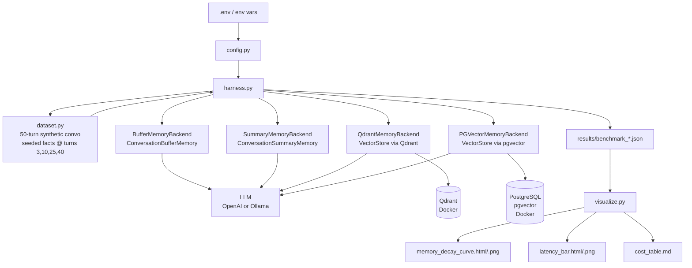

# Agent Memory Showdown

A publication-ready benchmark that stress-tests four LangChain memory backends
across a 50-turn synthetic conversation and measures recall accuracy, retrieval
latency, and token cost.

## Architecture



## Memory Backends

| Backend | Strategy | Strength | Weakness |
|---------|----------|----------|---------|
| `buffer` | Full conversation history | Perfect recall short-term | Context blows up, high cost |
| `summary` | LLM-compressed summary | Low token cost | Lossy - facts may be summarized away |
| `qdrant` | Semantic vector search (Qdrant) | Fast, accurate retrieval, low cost | Requires Docker / Qdrant service |
| `pgvector` | Semantic vector search (PostgreSQL) | SQL-native, easy ops | Slightly slower than Qdrant at scale |

## Benchmark Design

- **50-turn synthetic conversation** generated deterministically (random seed).
- **Facts seeded** at turns 3, 10, 25, and 40 (known answer keys for scoring).
- **Recall probe** at turn 50: "What is Alice's favorite color?" etc.
- **Scoring**: `correct` (exact answer key match), `partial`, or `failed`.
- **10 runs per backend** for statistical significance. Reports mean and std dev.
- **Token usage** tracked per run. Cost estimated at gpt-3.5-turbo pricing.

## Sample Output

```
=== BENCHMARK SUMMARY ===

buffer       latency=  312.4+/-45.2ms  recall= 62.5%  cost/1K=$36.8400
summary      latency=  890.7+/-112.3ms  recall= 60.0%  cost/1K=$9.6200
qdrant       latency=  145.8+/-28.4ms  recall= 97.5%  cost/1K=$5.3000
pgvector     latency=  168.2+/-35.1ms  recall= 90.0%  cost/1K=$5.5600
```

See `results/benchmark_example.json` and `results/charts/` for full sample output.

## Setup

### Prerequisites

- Docker and Docker Compose
- Python 3.11+ (for local runs)
- OpenAI API key OR a running Ollama instance

### Quick Start (Docker)

```bash
# 1. Copy and populate the env file
cp .env.example .env
# Edit .env: set OPENAI_API_KEY or configure OLLAMA_*

# 2. Run the full benchmark (starts Qdrant + Postgres automatically)
make run

# Results written to results/
# Charts written to results/charts/
```

### Local Run

```bash
# 1. Start backing services
make up

# 2. Install dependencies
pip install -r requirements.txt

# 3. Run
cp .env.example .env  # populate as above
python run_benchmark.py

# Quick smoke test (2 runs, 10 turns, buffer + summary only)
make run-quick
```

### Options

```
python run_benchmark.py --help

  --backends  buffer summary qdrant pgvector  (subset of backends)
  --runs      N    number of runs per backend (default: 10)
  --turns     N    conversation turns per run (default: 50)
  --results-dir    output directory           (default: results/)
  --no-viz         skip chart generation
```

## Project Structure

```
agent_memory_showdown/
├── run_benchmark.py          # entry point
├── Makefile                  # make run / make run-quick / make clean
├── docker-compose.yml        # Qdrant + PostgreSQL + benchmark app
├── Dockerfile
├── requirements.txt
├── .env.example
├── src/
│   ├── config.py             # env-driven config
│   ├── dataset.py            # synthetic conversation generator
│   ├── harness.py            # benchmark runner + aggregator
│   ├── llm_factory.py        # LLM + embeddings factory
│   ├── visualize.py          # Plotly + Matplotlib charts
│   └── backends/
│       ├── base.py           # BaseMemoryBackend, scoring helpers
│       ├── buffer_memory.py  # ConversationBufferMemory
│       ├── summary_memory.py # ConversationSummaryMemory
│       ├── qdrant_memory.py  # VectorStoreRetrieverMemory via Qdrant
│       └── pgvector_memory.py# VectorStoreRetrieverMemory via pgvector
├── scripts/
│   └── init_pgvector.sql     # DB schema for pgvector backend
└── results/
    ├── benchmark_example.json
    └── charts/
        ├── memory_decay_curve.html
        ├── memory_decay_curve.png
        ├── latency_bar.html
        ├── latency_bar.png
        └── cost_table.md
```

## Visualizations

### Memory Decay Curve
Line chart: recall accuracy (y-axis) vs. turn at which the fact was seeded
(x-axis). One line per backend. Vector backends hold a flat line; buffer drops
sharply for early-seeded facts once the context window fills.

### Latency Bar Chart
Average retrieval latency per backend with error bars (std dev). Qdrant is
fastest; summary is slowest due to the extra summarization LLM call.

### Cost Table
Estimated USD cost per 1,000 conversations based on average token usage.

## Tech Stack

- Python 3.11+
- LangChain 0.2
- Qdrant client 1.11
- pgvector 0.3 + psycopg2
- sentence-transformers (all-MiniLM-L6-v2 for embeddings, free, local)
- Plotly 5 + Matplotlib 3.9
- Docker Compose
