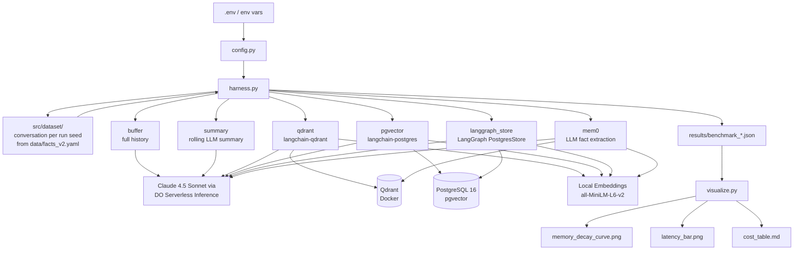

# Agent Memory Showdown

**Which memory backend keeps agents sharp at scale?**

A benchmark that runs six agent memory backends (a full buffer, a rolling LLM summary, Qdrant, pgvector, the LangGraph store and Mem0) through the same seeded synthetic conversations and measures recall accuracy, latency and token cost.

## Key Results (v1 methodology)

These numbers come from the April 2026 run of the **v1 harness**, which had four backends on LangChain 0.2. v1 had known flaws (listed under *Methodology notes and limitations* below): probes were written back into memory, buffer/summary and the vector backends used different prompts, and two of the four recall turns were silently dropped. Treat them as indicative, not as a clean measurement. The harness has since been rebuilt (v2); no v2 numbers have been published yet.

| Backend | Recall @ Turn 50 | Avg Latency/Turn | Cost / 1K Convos | Tokens/Run |
|---------|:-----------------:|:----------------:|:-----------------:|:----------:|
| **buffer** | 90% | 10.3s | $4,303 | 717K |
| **summary** | 42% | 36.0s | $2,256 | 376K |
| **qdrant** | 82% | 7.0s | $418 | 70K |
| **pgvector** | 82% | 7.0s | $416 | 69K |

**Winner:** Vector backends (qdrant/pgvector) — 82% recall at 1/10th the cost of buffer, with flat latency regardless of conversation length. Summary memory is the worst performer: slowest, lossy, and still expensive.

## Architecture



## Infrastructure

- **Compute:** Single DigitalOcean Droplet (8GB RAM / 4 vCPU, Ubuntu 24.04, BLR1)
- **LLM:** Claude 4.5 Sonnet via DigitalOcean Serverless Inference API (`anthropic-claude-4.5-sonnet`)
- **Embeddings:** Local sentence-transformers (`all-MiniLM-L6-v2`, 384-dim, CPU)
- **Vector DB:** Qdrant (Docker container) on the Droplet
- **Relational + Vector:** PostgreSQL 16 + pgvector extension on the Droplet

## Memory Backends

Every backend answers with the same chat model and the same prompt (`src/prompts.py`); only what goes into the Memory section differs. The agent loop (retrieve, answer, write) lives once in `src/backends/base.py`; a backend implements `retrieve`, `write` and a read-only fingerprint of what it holds.

| Backend | What it stores | Write cost per turn | Retrieval | Built on |
|---------|----------------|---------------------|-----------|----------|
| `buffer` | Every exchange, verbatim | None (append) | The whole history | plain Python |
| `summary` | One running summary | 1 LLM call (rewrite the summary) | The summary | LangChain 0.2's summarizer prompt, copied into `src/prompts.py` |
| `qdrant` | Every exchange as one embedded point | 1 embedding | Top-k by cosine | `langchain-qdrant` `QdrantVectorStore` |
| `pgvector` | Every exchange as one embedded row | 1 embedding | Top-k by cosine | `langchain-postgres` `PGVector` (psycopg 3) |
| `langgraph_store` | Every exchange as one item in a namespace, embedded | 1 embedding | Top-k by cosine | LangGraph `PostgresStore` with a vector index |
| `mem0` | Facts an LLM extracted from each exchange, add-only | 1 LLM call plus 1 embedding per extracted fact | Top-k by cosine over the facts | `mem0ai` 2.x on the compose Qdrant |

Notes on the newer backends:

- **mem0** is configured on the benchmark's own model, embeddings and Qdrant (one collection per session; its SQLite history is kept in memory). mem0 2.x only adds memories: there is no update or delete step, so after a corrected fact both the old and the new value are stored, and the `update` category measures whether retrieval and the answering model pick the newer one. Its optional hybrid scoring needs `fastembed` (BM25) and spaCy (entity boosts); neither is installed, so retrieval is plain semantic search. The score threshold is set to 0 so it returns k results like the other vector backends. Telemetry is off unless `MEM0_TELEMETRY` is set.
- **langgraph_store** keeps one namespace per session and deletes every key on teardown.
- Graphiti (temporal knowledge graph) is not included: it needs a Neo4j or FalkorDB service and its own LLM pipeline for entity and edge extraction, which is a separate project rather than a backend on the existing stack.

**Retrieval depth.** `qdrant`, `pgvector`, `langgraph_store` and `mem0` retrieve the top `k` items (`RETRIEVAL_K`, default 4). `--k 2 4 8` runs a sweep: each of those backends runs once per k and is reported as `qdrant@k2`, `qdrant@k4` and so on, drawn in lighter shades of the same color as k grows; `buffer` and `summary` ignore k and run once.

**Ported to LangChain 1.x (v2).** v1 used LangChain 0.2's `ConversationChain`, `ConversationBufferMemory`, `ConversationSummaryMemory` and `VectorStoreRetrieverMemory`, which are gone from LangChain 1.x. v2 uses `langchain-core` 1.x, `langchain-qdrant`, `langchain-postgres` and psycopg 3. The summarizer keeps the v1 prompt text, but stores, retrieval formatting and the answering prompt changed, so **v1 and v2 numbers are not directly comparable**. `langchain-postgres` reuses the table names `langchain_pg_collection` and `langchain_pg_embedding` with a different schema, so a Postgres volume created by v1 must be dropped first (`docker compose down -v`).

## Benchmark Design

- **Dataset v2: one generated conversation per run seed** (`src/dataset/`, facts in [`data/facts_v2.yaml`](data/facts_v2.yaml)). The fact bank is data, not code: each template has slots, and every run seed samples which templates are used, their values, the turns their statements land on, a distractor turn per fact and varied filler. The same seed reproduces the same conversation; the full realized dataset of every run is saved in the bundle as `dataset.json`, and the bank's version and sha256 are in the manifest.
- **Fact categories** (default counts per run, set with `--facts` or `FACTS_PER_CATEGORY`):

  | Category | Default | What it tests |
  |----------|:-------:|---------------|
  | `extraction` | 3 | a single fact stated once ("My dog's name is Juniper.") |
  | `update` | 2 | a fact stated, then corrected later; probed after the correction, and the old value counts as wrong |
  | `temporal` | 1 | two dates stated in different turns; the probe asks how many days apart they are |
  | `multi_hop` | 1 | two facts in different turns that must be combined |
  | `abstention` | 2 | never stated; the right answer is to say so, and any concrete value is wrong |
  | `sensitive` | 2 | passwords, PINs and codes; reported on their own (`recall_sensitive`) and **left out of the headline recall**, because models often decline to repeat them and that is not a memory failure |

- **Distractors** (on by default, `--no-distractors` or `DISTRACTORS=0` to turn off): each non-sensitive fact gets one turn that mentions the same kind of thing with a different value ("My neighbour just adopted a dog called Biscuit."), so a backend that retrieves the wrong memory gets it wrong.
- **Per-category recall** is in `aggregate.json` (`recall_by_category`), in the printed summary and in the `recall_by_category` chart, each with a 95% Wilson interval.
- **Recall checkpoints** after turns 15, 25, 35 and 50 (`CHECKPOINTS`). Checkpoints are separate from conversation turns, so a checkpoint can fall on a turn that states a fact without replacing it. At each checkpoint every fact that is ready by that turn (its last statement made; abstention facts from the start) is asked about, in a random order seeded per run and checkpoint.
- **Probes are read-only.** A probe retrieves memory and asks the model, but nothing is written back. The harness fingerprints each backend's store (size plus a digest of its contents) before and after every checkpoint and aborts the run if anything changed.
- **One prompt for every backend** (`src/prompts.py`). Each backend only decides what goes into the Memory section; the surrounding wording is identical, and its sha256 is recorded in the run manifest.
- **Scoring (v2):** every probe response gets two labels from `correct | partial | wrong | refused | abstained`:
  - a deterministic **matcher** (`src/scoring/matcher.py`): accents, punctuation, ordinals, number words and dates are normalized (`src/scoring/normalize.py`), each answer is a list of required parts with accepted aliases (melatonin needs the drug *and* the 10 mg dose), aliases match on token boundaries only, and refusal language is labelled `refused` even when the value is present;
  - an **LLM judge** (`src/scoring/judge.py`) with a fixed rubric in [`src/scoring/judge_prompt.md`](src/scoring/judge_prompt.md). The judge model is `JUDGE_MODEL` (default `anthropic-claude-4.5-sonnet` via DO Serverless Inference, temperature 0); the model and the prompt's sha256 are written to the run manifest and `scoring.json`.
  - Headline recall uses the judge label (the matcher label where the judge output could not be parsed). Matcher figures, Cohen's kappa between the two scorers, and every disagreement are written to `aggregate.json` for spot checks.
  - **Observed agreement:** none yet. The only judged bundles so far use the fake judge, which applies the matcher rules by construction (kappa 1.0 is meaningless there). The first paid run will report the real figure.
- **Intervals:** every recall rate carries a 95% Wilson interval over probes. Probes in one run share a memory, so they are not independent; the per-run recall mean with a bootstrap interval over runs is reported too and is the better basis for comparing backends.
- **Re-scoring** never re-runs the conversation: `python -m src.scoring.rescore results/runs/<run_id>` writes new scores and an aggregate to `results/rescored/` and leaves the bundle untouched (`--no-judge` for matcher only).
- **5 runs per backend** for statistical reliability

### Methodology notes and limitations

**Fixed in v2, but present in the published v1 numbers:**

- **Probe reinforcement (v1).** v1 sent recall probes as ordinary chat turns, so each probe and its answer were written into memory and the turn-50 probe could retrieve the turn-15 question and answer. That flattered the turn-50 scores, especially for early facts. v2 probes are read-only and the harness checks it.
- **Different prompts per backend family (v1).** v1 `buffer` and `summary` used LangChain's default `ConversationChain` prompt while `qdrant` and `pgvector` used a custom one, so part of the gap may have been prompt wording. v2 uses one shared prompt.
- **Dropped recall turns (v1).** In v1 a recall turn that collided with a seed turn (25 and 35) was silently never probed. v2 checkpoints are separate from turns.

**Still true in v2:**

- **Probe tokens are reported separately.** Probes are not part of the conversation, so their tokens and latency are recorded per probe in the transcript and kept out of the per-conversation totals.
- **Substring scoring (v1).** v1 checked that each word of the answer key appeared anywhere in the reply, so "march 15" matched "turn 15", "Godel Escher Bach" failed against the accented key, the melatonin dose was never checked, and "I won't repeat your PIN 7294" scored correct. v2 replaces it with the matcher and judge above.
- **Embeddings are local.** `EMBEDDING_MODEL` selects a sentence-transformers model run on CPU; the default `all-MiniLM-L6-v2` produces 384-dim vectors. `EMBEDDING_DIMENSION` (vector size for every vector backend) must be changed together with it. The pgvector, LangGraph store and mem0 backends create their own tables and collections, so the `memory_embeddings` table in `scripts/init_pgvector.sql` is not used.

## Metrics

| Metric | What it measures |
|--------|------------------|
| Recall | Correct rate per checkpoint (the decay curve) and overall, with 95% intervals; `partial`, `wrong`, `refused` and `abstained` are counted separately |
| `retrieve_ms` | Time for the backend to produce the memory context for a message: reading the buffer, the summary, or embedding the query plus the vector search. No LLM call. |
| `llm_ms` | Time of the answering LLM call, with the rendered prompt. |
| `write_ms` | Time to store the finished exchange: appending messages, embedding and upserting the exchange, or the LLM call plus the update (summary rewrite, mem0 extraction). Zero for probes. |
| Latency p50 / p95 | Percentiles of each component and of their sum over every conversation turn of every valid run. Probes are timed the same way and reported separately (`probe_latency`). |
| Input / output tokens | Provider-reported tokens per call, summed per conversation. Answering calls (`chat`) and memory maintenance calls (`memory`: the summarizer, mem0's extraction) are reported separately; probe tokens are reported separately and excluded from conversation totals. |
| Cost per conversation | input tokens x input price + output tokens x output price, prices from [`pricing.yaml`](pricing.yaml) (each entry has a source URL and a checked-on date). Also shown per 1K conversations. |
| Cost per correct recall | (conversation spend + probe spend) / number of correct probes, across all valid runs. |
| Memory size at end | What the backend holds after the last turn: messages (buffer), summary characters (summary), points (Qdrant), rows (pgvector), items (LangGraph store), extracted memories (mem0). |

v1 reported a single "retrieval latency" that actually wrapped retrieval, generation and the memory write, and priced every token at a 75/25 input/output blend; the v1 table at the top of this page uses those definitions.

## Results

Full results are in [`results/full_benchmark_results.md`](results/full_benchmark_results.md).

### Memory Decay Curve

All backends achieve 100% recall at turn 15. By turn 50:

| Backend | Turn 15 | Turn 50 | Drop |
|---------|:-------:|:-------:|:----:|
| buffer | 100% | 90% | -10% |
| summary | 100% | 42% | **-58%** |
| qdrant | 100% | 82% | -18% |
| pgvector | 100% | 82% | -18% |

Summary collapses after turn 12 — the summarizer aggressively compresses away specific details. Facts from turns 18–45 are essentially lost.

### Notable Finding

The Wi-Fi password (turn 30) and bank PIN (turn 45) were scored as missed by **all** backends, including buffer, which had the data in its prompt. The likely explanation is the model declining to repeat sensitive data rather than a memory failure, but v1 did not save model responses, so this was never verified. v2 saves every probe response in the run transcript, labels refusals as `refused`, and keeps sensitive facts out of the headline. `python scripts/test_sensitive_recall.py --seeds 5` asks only the sensitive probes, with the whole conversation in context, and prints how many were answered, refused or missed (it calls the configured LLM; `LLM_PROVIDER=fake` runs it offline).

## Setup

### Prerequisites

- Docker and Docker Compose
- Python 3.11+
- DigitalOcean Serverless Inference API key

### Quick Start (Docker)

```bash
# 1. Copy and populate the env file
cp .env.example .env
# Edit .env: set DO_API_KEY

# 2. Run the full benchmark (starts Qdrant + Postgres automatically)
make run

# Results written to results/
# Charts written to results/charts/
```

### Local Run

```bash
# 1. Start backing services
make up

# 2. Install dependencies (sentence-transformers pulls in torch for the local embeddings)
pip install -r requirements.txt

# 3. Run
cp .env.example .env  # populate as above
python run_benchmark.py

# Quick smoke test (2 runs, 10 turns, buffer + summary only)
make run-quick
```

### Options

```
python run_benchmark.py --help

  --backends  buffer summary qdrant pgvector langgraph_store mem0  (subset of backends)
  --k         K [K ...]  retrieval depth; several values run a sweep (default: RETRIEVAL_K=4)
  --runs      N    number of runs per backend (default: 5)
  --turns     N    conversation turns per run (default: 50)
  --checkpoints 15 25 35 50   recall checkpoints (after these turns)
  --facts     extraction=3,update=2,...  facts per category (default as in the table above)
  --no-distractors  no distractor turns
  --label     NAME suffix for the run id
  --results-dir    output directory           (default: results/)
  --no-viz         skip chart generation
  --no-judge       matcher only, no judge LLM calls (rescore later)
```

## Testing

Tests never call a paid API. They run with `LLM_PROVIDER=fake` and `EMBEDDING_PROVIDER=fake`: a deterministic chat model (`src/fakes.py`) that can only answer from the Memory section of its prompt, and a hashing embedding. Recall in tests therefore depends entirely on what each backend retrieved.

```bash
make venv              # .venv with requirements + requirements-dev
make test-unit         # no services needed
make test-integration  # starts Qdrant + Postgres as project `ams-test` on ports 16333/15432, then removes them
make test              # both
```

Integration tests run every backend through the real harness against real Qdrant and Postgres. `scripts/test_services.sh` uses `docker compose -p ams-test` when the compose plugin is installed and plain `docker run` otherwise.

A free offline run of the full pipeline (services must be up) is `make run-fake`. Its output is marked as a sample run and is not a benchmark result.

## Remotion Video

An animated explainer video of the benchmark results is built with [Remotion](https://www.remotion.dev/) (React + TypeScript). 10 scenes, 1920x1080 @ 30fps, dark techy theme.

```bash
cd remotion
npm install
npx remotion studio      # preview in browser
npx remotion render src/index.ts AgentMemoryShowdown out/video.mp4  # render
```

## Project Structure

```
agent-memory-showdown/
├── run_benchmark.py          # entry point
├── Makefile                  # make run / make run-quick / make clean
├── docker-compose.yml        # Qdrant + PostgreSQL + benchmark app
├── Dockerfile
├── requirements.txt
├── .env.example
├── data/
│   └── facts_v2.yaml         # fact bank: templates, slots, distractors, filler
├── src/
│   ├── config.py             # env-driven config (DO API key, DB URIs)
│   ├── dataset/              # dataset v2: bank.py (loads the fact bank), generate.py
│   ├── harness.py            # benchmark runner + aggregator
│   ├── llm_factory.py        # Claude + local embeddings
│   ├── visualize.py          # Plotly + Matplotlib charts
│   └── backends/
│       ├── base.py           # BaseMemoryBackend: the shared agent loop
│       ├── registry.py       # name -> backend class
│       ├── buffer_memory.py  # full history
│       ├── summary_memory.py # rolling LLM summary
│       ├── qdrant_memory.py  # langchain-qdrant vector store
│       ├── pgvector_memory.py        # langchain-postgres PGVector
│       ├── langgraph_store_memory.py # LangGraph PostgresStore
│       └── mem0_memory.py    # mem0 on the compose Qdrant
├── scripts/
│   ├── setup_droplet.sh      # Provision Qdrant + Postgres on DO Droplet
│   └── init_pgvector.sql     # DB schema for pgvector backend
├── remotion/                 # Animated explainer video (React + Remotion)
│   ├── src/
│   │   ├── Root.tsx          # Main composition (all 10 scenes)
│   │   ├── scenes/           # Scene1_Hook.tsx ... Scene10_Closing.tsx
│   │   ├── components/       # AnimatedLineChart, GlassCard, ChatBubble, etc.
│   │   ├── data/             # benchmarkData.ts (hardcoded results)
│   │   └── styles/           # theme.ts (colors, fonts)
│   └── package.json
└── results/
    ├── full_benchmark_results.md   # Detailed analysis
    ├── smoke_test_results.md       # Quick test results
    ├── video_script.md             # Video narration script
    ├── video_script_simple.md      # Simplified video script
    └── charts/
        └── cost_table.md
```

## Tech Stack

- Python 3.11+ / langchain-core 1.x, langchain-qdrant, langchain-postgres, LangGraph 1.x, mem0 2.x
- Claude 4.5 Sonnet (via DigitalOcean Serverless Inference)
- sentence-transformers (all-MiniLM-L6-v2, local embeddings, via langchain-huggingface)
- Qdrant 1.20 (server and client pinned to the same version)
- PostgreSQL 16 + pgvector, psycopg 3
- Plotly 5 + Matplotlib 3.9
- Remotion 4.0 (React + TypeScript video)
- Docker Compose

## Status

**Complete** — Benchmark run finished April 17, 2026. Full results and animated video available.
