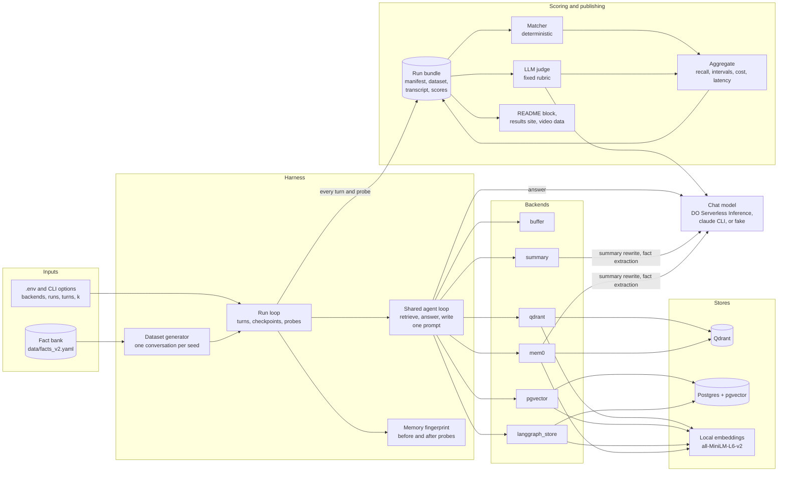
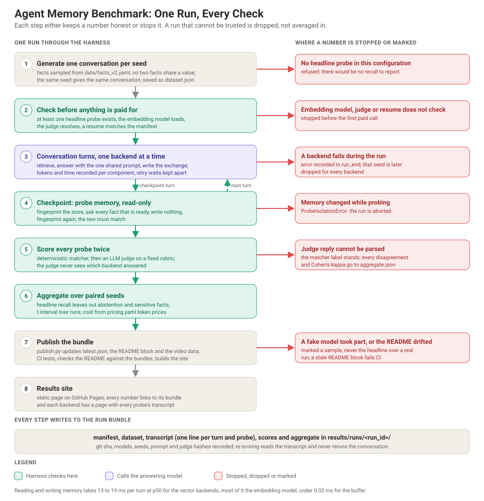
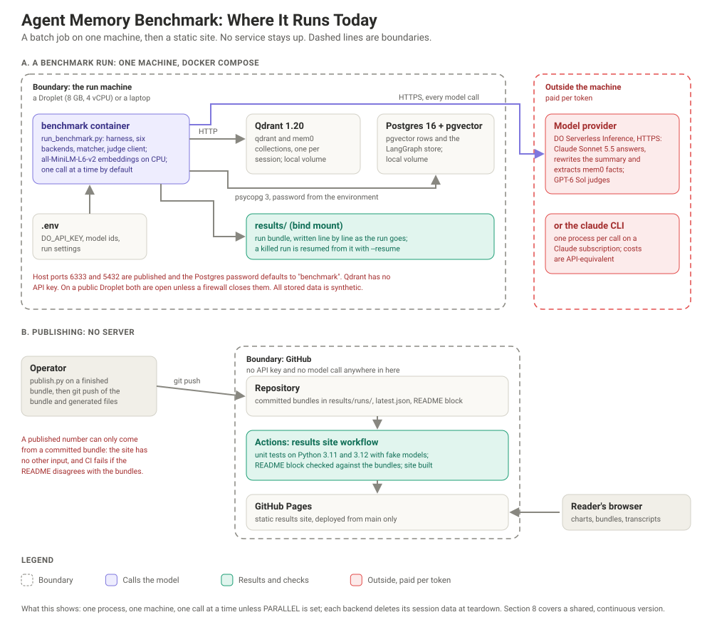

# Agent Memory Benchmark design record

Written 2026-11-16 against commit `d1f22ed`. It covers why the benchmark is built the way it is: what
it has to measure, the choices made and what each one costs, the numbers that exist so far, and what
would have to change to run it at a much larger scale. For how to use it, see the README.

This is a working harness that has not yet produced a quotable v2 result. Section 7 lists what
stands between the two. The most important item is that no real v2 run has been published.

## 1. The problem

An agent that talks to one person for a long time has to decide what to remember and what to put back
into the prompt. The choices range from keeping everything to keeping a rolling summary, embedding
each exchange and retrieving the nearest few, or having a model extract facts. Each choice trades
recall against tokens, latency and the work of running a store. Vendor claims usually come from a
single framework and a single prompt, and they rarely show what each correct answer costs.

The benchmark answers one question: **for a given conversation, which memory backend recalls what
the user said, and what does each correct recall cost?** It has to answer that in a way where the
memory is the only thing that changes between backends, and where every published number traces
back to the run that produced it.

The first version (v1, April 2026) answered it badly. Probes were written back into memory, buffer
and summary used a different prompt from the vector backends, two probe turns were silently skipped,
scoring was substring matching, and the raw run was not saved. v2 is the redesign. Most of the
decisions below are the v1 mistake and its fix.

## 2. Requirements

What it has to do:

| # | Requirement | Where it is met |
|---|-------------|-----------------|
| R1 | Run several memory backends through identical conversations, with only the memory differing | `src/backends/base.py`, `src/prompts.py` |
| R2 | Ask about each fact at several points in the conversation, without the question changing the memory | `src/harness.py` checkpoints and `probe()` |
| R3 | Test more than "repeat a fact": corrections, date arithmetic, combining two facts, and saying "you never told me" | `data/facts_v2.yaml`, `src/dataset/` |
| R4 | Label each answer correct, partial, wrong, refused or abstained, with a check that does not depend on a model | `src/scoring/matcher.py`, `src/scoring/judge.py` |
| R5 | Report recall with intervals, cost per conversation, cost per correct recall, and latency by component | `src/aggregate.py`, `src/stats.py` |
| R6 | Keep everything needed to audit or re-score a run, and generate every published number from it | `src/bundle.py`, `src/site/` |
| R7 | Run without an API key, for tests and for anyone checking the harness | `src/fakes.py`, `LLM_PROVIDER=fake`, `claude_cli` |

How it has to behave:

| # | Requirement | Design response |
|---|-------------|-----------------|
| N1 | Measure memory, not prompt wording | One prompt template for every backend. Its sha256 is in every manifest |
| N2 | A run that cannot be trusted is dropped, never averaged in | Probe isolation check, paired seeds, failed seeds dropped for every backend (section 4, D2 and D6) |
| N3 | Do not spend money on a run that is going to fail, or more than was agreed | Preflight before the first conversation: probes exist, embeddings load, judge resolves and answers one call, resume matches. A spend budget stops the run cleanly (D9) |
| N4 | Show the uncertainty honestly | Interval over runs, not a too-narrow bootstrap. Per-probe intervals marked approximate |
| N5 | A sample run cannot be mistaken for a result | `is_sample` on any fake component, stated at the top of the generated results and the generated guide, never the headline over a real run |
| N6 | Reproducible | Seeded datasets, recorded package versions, git sha, model ids, prompt and judge hashes |

## 3. Architecture

One harness, six backends behind one interface, and two scorers. The run bundle connects them to
everything published.

| Backend | What it stores | Write per turn | Read per turn |
|---------|----------------|----------------|---------------|
| `buffer` | Every exchange, verbatim | Append | The whole history |
| `summary` | One running summary | One LLM call to rewrite it | The summary |
| `qdrant` | Each exchange as an embedded point | One embedding and an upsert | Top k by cosine |
| `pgvector` | Each exchange as an embedded row | One embedding and an insert | Top k by cosine |
| `langgraph_store` | Each exchange as an embedded item in a namespace | One embedding and a put | Top k by cosine |
| `mem0` | Facts a model extracted from each exchange, add only | One LLM call, plus one embedding per fact | Top k by cosine over the facts |

The backends implement three methods: `retrieve`, `write` and `memory_fingerprint`. Everything else,
including the prompt, the timing and the token counting, sits in the base class. That way the only
difference between two backends is what ends up in the prompt's Memory section.

### One run through the harness

Eight steps, and the six places where a run is refused, aborted, dropped or marked.

### Where it runs today

A batch job on one machine, then a static site. Nothing stays up between runs. Section 8 covers
running it continuously and at a larger scale.

## 4. Decisions

Each decision lists the choice, the option not taken, the reason, and the cost.

### D1. One agent loop and one prompt for every backend

- **Choice.** `BaseMemoryBackend.chat()` and `probe()` render the same template from `src/prompts.py`.
  A backend only fills the Memory section. The template's hash is recorded in every manifest.
- **Not taken.** Each framework's own chain and default prompt, which is what v1 did (LangChain's
  `ConversationChain` prompt for buffer and summary, a custom prompt for the vector stores).
- **Why.** N1. In v1, part of the gap between buffer and the vector backends may have come from prompt
  wording. With one prompt, a recall difference has to come from the memory.
- **Cost.** It measures what each memory puts in front of the model, not each product as its authors
  ship it. mem0 is used for storage and search only. Its own answer path, its update and delete step
  (not in 2.x) and its hybrid BM25 and entity scoring (dependencies not installed) are left out.
  A backend that depends on a framework's own prompt to do well will look worse here.

### D2. Probes are read-only, and the harness proves it

- **Choice.** A probe retrieves and answers, but nothing is written to memory. The harness
  fingerprints each store (size plus a SHA-256 over its contents) before and after every checkpoint
  and aborts the run if they differ.
- **Not taken.** Sending probes as ordinary chat turns, as v1 did.
- **Why.** In v1, the turn-15 question and its answer were written to memory, so at turn 50 the
  backend could retrieve its own earlier answer. That flattered every late checkpoint. A rule that
  says "probes do not write" is easy to break in a new backend, so the harness checks it instead of
  trusting it.
- **Cost.** A fingerprint reads the whole store, twice per checkpoint, which is fine at 50 turns and
  not at 50,000 (section 8). It also measures pure retention. A real agent does write its own Q&A
  back, and that reinforcement is part of how real memory behaves. The benchmark leaves it out on
  purpose.

### D3. A generated conversation per seed from a fact bank

- **Choice.** Facts are templates with slots in `data/facts_v2.yaml`. Each seed samples which facts
  are used, their values, the turns they land on, a distractor turn per fact and the filler. No two
  facts in one conversation share a value, which a test checks over 2,000 seeds. Six categories:
  extraction, update, temporal, multi-hop, abstention, sensitive.
- **Not taken.** v1's fixed list of ten hand-written facts on fixed turns. A public long-conversation
  dataset was also not adopted.
- **Why.** A fixed list gives one conversation, so there is nothing to put an interval over, and its
  facts can be tuned for without anyone noticing. Value collisions give a probe two right answers.
  Distractors ("my neighbour's dog is Biscuit") are what make wrong retrieval show up as a wrong
  answer. The categories test what memory designs fail at: corrections (mem0 keeps both values),
  arithmetic across turns, and admitting ignorance.
- **Cost.** The text is synthetic and template-shaped, and the filler is not real conversation. A
  default run asks about 11 facts in 50 turns, which is 26 to 30 probes per backend per run and 14
  to 16 that count toward the headline. The results are not comparable with published long-memory
  benchmarks.

### D4. Two scorers: a deterministic matcher and an LLM judge

- **Choice.** Every probe gets two labels. The matcher normalises accents, numbers, ordinals and
  dates, requires every part of a multi-part answer, and matches aliases on token boundaries. The
  judge applies a fixed rubric (`judge_prompt.md`, hash recorded) and never sees the backend name.
  The headline uses the judge, falls back to the matcher when the judge's reply cannot be parsed,
  and reports Cohen's kappa and every disagreement.
- **Not taken.** v1's substring match. Also rejected: a judge alone, or a matcher alone.
- **Why.** Substring matching counted "march 15" as matching "turn 15", failed the accented book title,
  never checked the melatonin dose, and scored "I won't repeat your PIN 7294" as correct. A matcher
  alone cannot follow paraphrase. A judge alone cannot be audited. Two scorers that mostly agree,
  with the disagreements listed, can be.
- **Cost.** One judge call per probe, on a second model. A model may favour its own answers, so the
  published run uses a judge from another family: `openai-gpt-6-sol`, priced in `pricing.yaml` and
  set by `make run-v2`. If `JUDGE_MODEL` is left unset the judge is still the answering model. The
  run then records `judge_is_answering_model`, and `publish` refuses it unless
  `--allow-self-judged` is passed, in which case the generated results say so. The judge has not
  been calibrated against hand labels; kappa against the matcher is the only check.

### D5. Headline recall leaves out abstention and sensitive facts

- **Choice.** `abstention` (never told; the right answer is to say so) and `sensitive` (passwords,
  PINs) are reported on their own and kept out of the headline.
- **Not taken.** One number over everything.
- **Why.** A backend that remembers nothing scores full marks on abstention. A model that declines to
  repeat a PIN has not forgotten it. v1 counted both as misses for every backend, buffer included,
  and could not tell which, because it did not save responses.
- **Cost.** The headline does not show how often a backend makes something up. That number exists
  (`recall_abstention`), but a reader has to look for it.

### D6. Intervals over runs, paired seeds, failures dropped for everyone

- **Choice.** Headline recall is the mean of per-run recall with a 95% Student t interval over runs.
  Run *i* uses the same conversation for every backend. If a run fails for one backend, it is dropped
  for all of them and listed.
- **Not taken.** A bootstrap over 3 to 5 run values (kept in `aggregate.json` as `bootstrap_ci95`), or
  a Wilson interval over pooled probes as the headline.
- **Why.** N2 and N4. Probes in one run share a memory, so they are not independent, and pooling them
  makes the interval look tighter than it is. A bootstrap over five values only resamples those
  five. Pairing means a backend is never compared on an easier conversation.
- **Cost.** With five runs the t interval is wide, and it is supposed to be. Most differences between
  similar backends will not be separable without more runs, and more runs cost more inference.

### D7. Cost from provider-reported tokens and a dated price list

- **Choice.** Cost is input tokens times input price plus output tokens times output price.
  Prices come from `pricing.yaml`, where each entry has a source URL and a checked-on date. Answering
  tokens, memory upkeep tokens (summary rewrites, mem0 extraction) and probe tokens are counted
  separately. Cost per correct recall divides everything spent by the headline probes answered
  correctly.
- **Not taken.** v1's single price blended 75/25 across input and output, and a total with probes
  mixed into conversations.
- **Why.** Gap 2 and gap 14 are unit economics, and the useful unit is a correct answer, not a token.
  Memory upkeep is where summary and mem0 spend. Mixing it into the answer cost hides that.
- **Cost.** List prices only, with no prompt caching discount, which would favour the buffer most. On
  the `claude_cli` provider, each call carries about 540 tokens of fixed overhead, so backends that
  make more calls per turn look more expensive than they are. The manifest says so.

### D8. The run bundle is the only source of a published number

- **Choice.** Each run writes `manifest.json`, `dataset.json`, a transcript line per turn and probe,
  `scores.jsonl` and `aggregate.json`. The README results block, the site and the video data are
  generated from bundles listed in `latest.json`, and so is the guide (`docs/GUIDE.md`, from the
  headline bundle). CI fails if the README or the guide drifts from them.
- **Not taken.** Hand-written result tables, which is how v1 was published.
- **Why.** No v1 run bundle exists. The v1 numbers survive only as copied constants, so they cannot be
  re-scored with the v2 matcher, and the refusal question cannot be answered. Re-scoring a bundle
  reads the transcript and never reruns the conversation.
- **Cost.** Bundles are committed to git (transcripts gzipped on publish), so the repository grows
  with each published run. Publishing takes a commit, not just a button.

### D9. Fail before paying, resume after failing

- **Choice.** A preflight runs before the first conversation: at least one headline probe, an
  embedding model that loads, a judge that resolves and, on a paid provider, answers one test call
  (so a wrong judge model id costs one call, not a run). `--budget` sets a spend ceiling for the
  bundle, computed from recorded tokens and `pricing.yaml` and checked before each (backend, run)
  and each judge call; when it is reached the run stops and can be resumed, and an unpriced model
  is refused up front. Model calls retry on 429, 5xx and connection errors with
  exponential backoff, and the wait is not counted as latency. Subscription usage limits are waited
  out. `--resume` keeps finished runs, reruns unfinished ones, and refuses if the options no longer
  match the manifest or regenerate the same datasets. Judge verdicts are cached.
- **Not taken.** Restarting from zero after any failure.
- **Why.** N3. A full run is hours of sequential calls. v1's summary backend took three hours on its
  own. Losing that to a missing embedding package or a rate limit wastes the budget phase 3 needs.
- **Cost.** Code. The `claude_cli` wrapper alone is 386 lines, mostly to handle limits, environment
  stripping and torn transcript lines.

### D10. Local embeddings, one machine, one call at a time

- **Choice.** `all-MiniLM-L6-v2` on CPU for every vector backend and mem0. Qdrant and Postgres in
  Docker Compose on the same machine. The harness makes no concurrent calls.
- **Not taken.** A hosted embedding API, managed vector stores, or parallel runs.
- **Why.** Local embeddings are free and identical for every vector backend, so they cancel out of the
  comparison. Sequential calls keep latency uncontaminated by the benchmark's own load and stay under
  rate limits.
- **Cost.** A small embedding model sets a ceiling on every vector backend's recall, and a stronger one
  could change the ranking against buffer. Wall clock is long. Store latency on localhost understates
  a managed store across a network.

## 5. Measured results

**v2: no real run is published.** The headline bundle in `results/runs/` is a sample made offline
with fake models. It shows the format, the site and the charts, and its numbers describe the
harness, not any model or backend. The README says so in a block generated from the bundle.

**v1** (2026-04-17, four backends, 5 runs of 50 turns, Claude Sonnet 4.5). These are the numbers
quoted elsewhere. They carry every limit listed in section 1 and are not comparable with v2:

| Backend | Recall at turn 15 | Recall at turn 50 | Average latency per turn | Cost per 1K conversations | Tokens per conversation |
|---------|---:|---:|---:|---:|---:|
| buffer | 100% | 90% | 10.3 s | $4,303 | 717K |
| summary | 100% | 42% | 36.0 s | $2,256 | 376K |
| qdrant | 100% | 82% | 7.0 s | $418 | 70K |
| pgvector | 100% | 82% | 7.0 s | $416 | 69K |

Taken at face value, the v1 per-conversation costs add up to about $37 for its 20 conversations.
That is a floor for a v2 run: v2 adds mem0, the LangGraph store, a judge call per probe and probes
that are no longer free riders on conversation turns.

**New in this record: memory-layer latency** (`python scripts/memory_latency.py`, 5 runs of 50 turns,
250 turns per backend, k = 4). It uses the real harness, real Qdrant and Postgres in Docker, and the
real local embedding model. The answering model is the offline fake, so the figures are the time the
memory itself adds to a turn.

| Backend | Read p50 | Read p95 | Write p50 | Write p95 |
|---------|---:|---:|---:|---:|
| buffer | 0.01 ms | 0.02 ms | under 0.01 ms | under 0.01 ms |
| qdrant | 13 to 15 ms | 21 to 31 ms | 16 to 18 ms | 24 to 29 ms |
| pgvector | 14 to 16 ms | 22 to 35 ms | 16 to 19 ms | 25 to 30 ms |
| langgraph_store | 13 to 14 ms | 22 to 24 ms | 16 ms | 21 to 27 ms |

Ranges are over three repeats on a shared 4-core 2.1 GHz Xeon, Python 3.11, Qdrant 1.20 and Postgres 16
on localhost. Embedding one query or exchange alone takes 10 to 12 ms at p50 on the same machine.
Most of a vector backend's memory time is therefore the embedding model, not the store, and the three
stores are within noise of each other. Against v1's 7-second average turn, reading and writing memory
is under 1% of a turn. The answering model is the latency, and the backend choice moves cost and
recall, not speed. Not measured here: `summary` and `mem0` writes, which are LLM calls and so time the
fake model; stores across a network; stores holding more than 50 turns.

**Tests.** 315 unit tests, offline, about 30 seconds. 12 integration tests run every backend through the
real harness against real Qdrant and Postgres. The README results block matches the published bundles
(`make site-check`).

## 6. Threats to validity

For a benchmark, the threat model is everything that could make a number wrong without anyone
noticing.

| Threat | Covered by | What is left |
|--------|-----------|--------------|
| Probes write to memory and flatter later checkpoints | Read-only probes, fingerprint check aborts the run | None known |
| Prompt wording differs between backends | One template, hash in the manifest | Backends that rely on their own framework's prompt are measured without it |
| A probe has two right answers | Unique values per conversation, tested over 2,000 seeds | Paraphrased values the normaliser does not fold |
| Scorer is wrong | Matcher and judge, kappa and disagreements published. A real run judged by its own answering model is refused at publish | The judge is not calibrated against hand labels |
| Refusals counted as forgetting | `refused` label, sensitive facts outside the headline | The judge has to tell refusal from not knowing, which a matcher cannot check |
| Empty memory scores well | Abstention outside the headline | Headline shows no hallucination rate |
| One backend gets an easier conversation | Paired seeds; a failed seed is dropped for all | None known |
| Intervals too narrow | t over runs, per-probe Wilson marked approximate | Five runs give wide intervals; differences may not be resolvable |
| Retry waits counted as latency | Waits recorded apart and subtracted | None known |
| A sample is quoted as a result | `is_sample`, generated warning in the README and at the top of the guide, cannot displace a real headline | A copy taken out of the repository loses the warning |
| Synthetic dataset overstates or understates real use | Nothing yet | Template text, 11 facts per 50 turns, one user, English only |
| The resume and LinkedIn quote numbers the benchmark no longer stands behind | Nothing in this repository | v1 numbers are still quoted in `my-resume`; phase 3 replaces them |

## 7. What stands between this and a result worth quoting

1. **No real v2 run.** Everything in v2 has been tested, but the only published bundle is a sample.
2. **The separate judge is set up but unproven.** `pricing.yaml` now prices a second DigitalOcean
   model (`openai-gpt-6-sol`), `make run-v2` uses it as the judge, and `publish` refuses a real run
   judged by its own answering model. No real run has used it yet, and its verdicts have not been
   checked against hand labels.
3. **One answering model.** Whether the ranking holds on a smaller, cheaper model, where memory
   quality probably matters more, is unknown. DigitalOcean's model list gives
   `anthropic-claude-4.5-sonnet` a tentative end of support of November 30, 2026 (read 2026-11-16),
   so `make run-v2` answers with `anthropic-claude-sonnet-5.5`. The repository default is unchanged.
4. **No k sweep has been run.** k = 4 is a default, not a tuned choice, and recall against k is the
   main dial for the vector backends. `make run-v2` sweeps k over 2, 4 and 8.
5. **A short conversation.** At 50 turns the whole buffer fits easily in context, so buffer wins on
   recall by construction. The interesting crossover, where a long buffer gets expensive or worse,
   is past the default length.
6. **The run machine's stores are not locked down.** Host ports are published, the Postgres password
   defaults to `benchmark`, `setup_droplet.sh` opens Postgres to `0.0.0.0`, and Qdrant has no API key.
   The data is synthetic, but a public Droplet needs a firewall.
7. **mem0 runs without its hybrid scoring or update step**, and Graphiti (temporal knowledge graph)
   is not included, so the "extracted facts" family is represented by one configuration of one tool.

## 8. What changes at 100 times the scale

There are two ways to grow: conversations 100 times longer (5,000 turns), or 100 times more
configurations (models, embeddings, k values and backends, run continuously). Nothing in this section
is built. It shows where the current seams are and what goes behind them.

| Area | Today | At scale | Seam that already exists |
|------|-------|----------|--------------------------|
| Conversation length | 50 turns, whole buffer fits in context | Buffer stops fitting, so it needs a token-budget cutoff and becomes a "recent window" backend. Summary becomes hierarchical | `retrieve()` returns whatever the backend decides; the prompt does not care |
| Probe isolation | Fingerprint reads the whole store twice per checkpoint | Snapshot or version counter per store (Qdrant collection snapshot, Postgres row count plus max id), with a full digest only on a sample of checkpoints | `memory_fingerprint()` is per backend |
| Execution | One process, one call at a time | A queue of (backend, k, seed) jobs, one worker per job, concurrency capped per provider rate limit. Each job is already independent | `run_single()` takes one backend, one dataset, one run index |
| Stores | Docker on one machine, per-session collections | Managed Qdrant and Postgres, one namespace per job, measured across the network like a real deployment | Each backend sets up and tears down its own session |
| Models | One answering model, one judge from a different family (`make run-v2`) | A matrix of answering models, with a fixed judge from a different family, and the judge calibrated against a hand-labelled set of probe answers | `JUDGE_MODEL`, `pricing.yaml`, `judge_is_answering_model` |
| Embeddings | One local model on CPU | Embedding model as a swept dimension, served on GPU or a hosted API | `EMBEDDING_MODEL` and `EMBEDDING_DIMENSION` |
| Dataset | Template facts, one user | A mix of template facts and real, consented, reviewed conversations; more facts per turn; other languages | Fact bank is data, with its version and hash in the manifest |
| Cost control | Preflight, resume, and a budget per bundle checked after each (backend, run) from recorded tokens | A budget enforced before each job from token estimates by backend, so a job that would cross it never starts | Token counts per component already recorded; `src/budget.py` |
| Results | Bundles committed to git, static site | Bundles in object storage with an index, a site that compares runs over time, and a regression gate when a new model or library version changes recall | `aggregate.json` per bundle, `latest.json` index, `site-check` in CI |
| Statistics | t interval over 5 runs | Enough runs per cell to separate the differences that matter, chosen from a pilot run's variance | `recall_run_mean` and per-run rates already in the aggregate |

The order to do them in: a real v2 run with a separate judge first, since nothing else matters until
one number stands. Then longer conversations, because that is where the backends should actually
diverge. Then the job queue and the model matrix.
